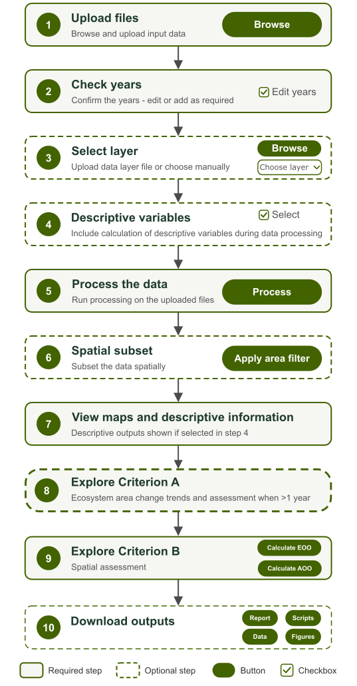

<p align="center">


</p>

# EcoCAT Assessment Tool

**Use the tool online:** <https://assess.ecocatproject.org>

No installation is needed to use the online version. To run the tool on
your own computer, see [Running the tool
locally](#running-the-tool-locally).

For a simple 10-step workflow of the assessment process, see [Assessment
tool process](#assessment-tool-process).

## Introduction

The loss of biodiversity and degradation of natural habitats are making
ecosystems increasingly vulnerable to collapse. Resilient ecosystems are
essential to human and planetary well-being, providing services such as
clean air and water, climate regulation, nutrient cycling, crop
pollination, and recreation.

An ecosystem encompasses a community of interacting species and their
physical environment. Ecosystems can be classified using the [**IUCN
Global Ecosystem Typology
(GET)**](https://global-ecosystems.org/ "url link to the global ecosystem typology webpage"),
which provides a standard framework for describing ecosystem types
worldwide, and assessed using the [**IUCN Red List of Ecosystems
(RLE)**](https://iucnrle.org/rle-categ-and-criteria "url link to the IUCN Red List of Ecosystems criteria"),
which ranks ecosystems according to their risk of collapse. Together,
the GET and RLE provide a globally consistent framework for mapping,
assessing and monitoring ecosystem conservation status.

## What is an ecosystem risk assessment?

An ecosystem risk assessment evaluates the likelihood that an ecosystem
is at risk of collapse. The IUCN Red List of Ecosystems protocol uses
information on ecosystem geographic distribution, changes in
distribution over time, and the severity and extent of degradation to
assess the risk of ecosystem collapse using scientifically robust and
internationally recognised criteria described in the [**RLE
guidelines**](https://portals.iucn.org/library/sites/library/files/documents/2024-021-En.pdf).

The IUCN RLE has been adopted as a headline indicator in the [Global
Biodiversity Framework
(GBF)](https://www.cbd.int/gbf "url link to the global biodiversity framework website")
of the UN Convention on Biological Diversity, highlighting its
importance for tracking ecosystem conservation status and supporting
decision-making around the world.

## The EcoCAT project

This Ecosystem Assessment tool is part of the [**EcoCAT (Ecosystem
Conservation Assessment
Tools)**](https://www.kew.org/science/our-science/projects/EcoCAT "url link to the RBG Kew public website project page")
project, a broader initiative to develop open, modular and user-friendly
tools that support ecosystem mapping and assessment in line with the
IUCN Red List of Ecosystems framework. A landing page for the current
tools in development can be found at
[**ecocatproject.org**](https://ecocatproject.org "url link to the ecocat project landing page for both the mappign and assessment tools").

## How does this tool support ecosystem assessments?

The **EcoCAT Assessment Tool** helps users assess the risk of ecosystem
collapse following the guidelines and criteria of the IUCN Red List of
Ecosystems.

Users begin the assessment process by uploading ecosystem maps, which
may have been generated using mapping tools or obtained from published
datasets. The tool accepts ecosystem maps in GeoTIFF (.tif) raster
format for a single year or multiple years (*n.b.:* maps from at least
two distinct years are required to assess change over time,
i.e. Criterion A). Currently, the tool assists with the following steps
of the RLE assessment process:

- **Ecosystem Description:** Document information describing the
  assessment unit

- **Criterion A:** Assess risk associated with reductions in geographic
  distribution over time.

- **Criterion B:** Assess risks associated with restricted geographic
  distribution, measured using Extent of Occurrence (EOO) and Area of
  Occupancy (AOO).

The tool generates outputs that support the assessment process and can
be downloaded for use in reports, publications, and further analyses
(see Report & Data tab):

- Assessment report

- Data tables

- Spatial data

- Publication-ready figures

- R scripts (to repeat analysis)

## Who is this tool for?

This tool is intended for practitioners, researchers, conservationists,
and decision-makers undertaking IUCN Red List of Ecosystems assessments.
It is designed for users who already have ecosystem maps and wish to
assess ecosystem risk of collapse following the <a
href="https://portals.iucn.org/library/sites/library/files/documents/2024-021-En.pdf"
target="_blank" rel="noopener noreferrer"
title="pdf file of the RLE ecosytem assessment guidelines">IUCN Red List
of Ecosystem assessment guidelines</a>.

## Future work

Future releases of the EcoCAT Assessment Tool will include support for
the calculation of ecosystem degradation based on widely applicable
indicators to support assessments of **Criterion C** (Environmental
degradation) and **Criterion D** (Disruption of biotic processes or
interactions). Additional planned developments include methods to
account for uncertainties in spatial distribution and integration with
the EcoCAT Mapping Tool.

The EcoCAT team is currently developing an ecosystem Mapping Tool to
support the production of ecosystem maps and time series required for
the assessment and reassessment of the RLE spatial distribution
criteria. These maps will include measures of mapping uncertainty and
will be optimised for direct use in the EcoCAT Assessment Tool.

## Running the tool locally

The EcoCAT Assessment Tool can also be run on your own computer.
[R](https://cran.r-project.org/) version 4.3 or later and
[RStudio](https://posit.co/download/rstudio-desktop/) are recommended.

### 1. Install the required packages

Run this once in R to install any packages you don’t already have:

``` r
pkgs <- c("terra", "base64enc", "bsicons", "bslib", "data.table", "dplyr", 
"DT", "elevatr", "exactextractr", "flextable", "future", "ggplot2", 
"ggspatial", "httr2", "leafem", "leaflet", "leaflet.extras", 
"leaflet.extras2", "lubridate", "mgcv", "plotly", "progress", 
"promises", "purrr", "quarto", "RColorBrewer", "rnaturalearth", 
"rnaturalearthdata", "rstac", "sf", "shiny", "shinycssloaders", 
"shinythemes", "shinyWidgets", "stars", "stringr", "tidyr", "tinytex", 
"xml2", "zip", "stats", "utils", "grDevices", "grid", "htmltools", 
"rmarkdown", "renv", "knitr", "rmdformats", "htmlwidgets") 

install.packages(setdiff(pkgs, rownames(installed.packages())))
```

### 2. Launch the app directly from GitHub

``` r
shiny::runGitHub(repo = "ecocat", username = "rdcritchlow")
shiny::runGitHub(repo = "ecocat-assessment", username = "ecocatproject")
```

This downloads the latest version of the tool to a temporary folder and
opens it in your web browser. Nothing is permanently installed.

### Alternative: keep a local copy

To work offline or keep a fixed version, click the green **Code** button
on GitHub and choose **Download ZIP**, then unzip the file. In R, run
the app by giving the path to the unzipped folder:

``` r
shiny::runApp("path/to/ecocat-assessment-tool")
```

## Assessment tool process

The process to implement an ecosystem assessment using the [**EcoCAT
Assessment Tool**](https://assess.ecocatproject.org) is shown below

<p align="center">



</p>
