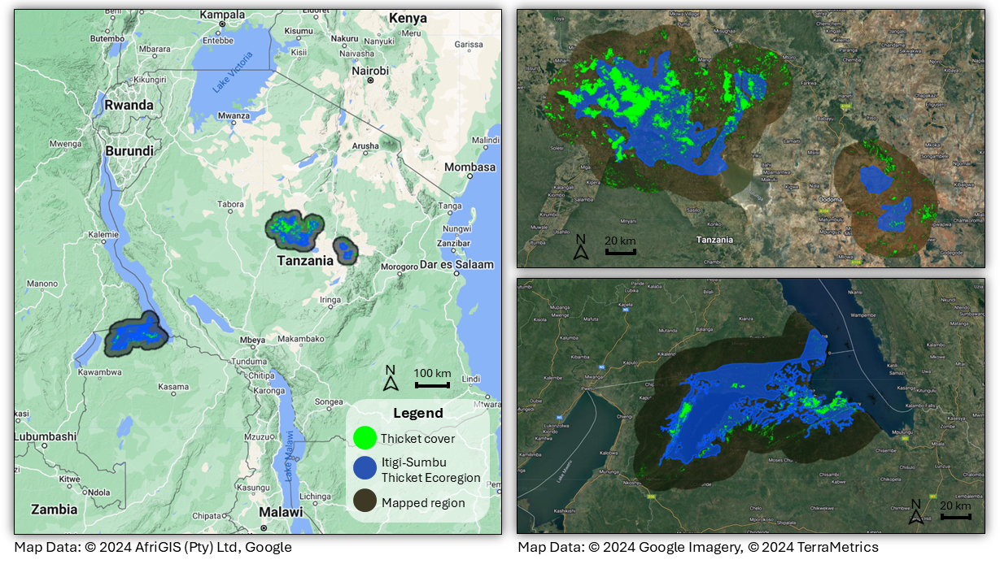
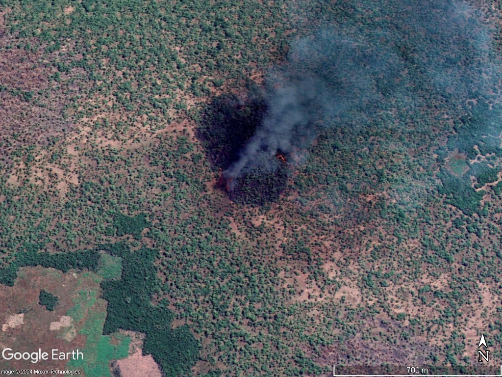

## Overview

The **Itigi-Sumbu thicket** is a rare and poorly understood ecosystem of dense, primarily deciduous woody vegetation with a closed, low canopy. It occurs in two disjunct regions: the **Itigi area** of central Tanzania (Singida, Dodoma, and Tabora regions), which holds around 85% of the global extent, and the **Sumbu region** of northeastern Zambia (Northern Province, near Lakes Mweru Wantipa and Tanganyika). A small occurrence also exists in the Democratic Republic of Congo (@fig-map).

The ecosystem is classified as **Endangered (EN)** under the IUCN Red List of Ecosystems, plausibly ranging between Endangered and Critically Endangered (EN–CR).

{#fig-map width="100%"}

------------------------------------------------------------------------

## Ecology & Habitat

The thicket grows on specialised **acidic, sandy soils with duricrust** (pH 4.0–4.5), which strongly determine its distribution and are distinct from the surrounding Miombo woodland. The interlaced canopy eliminates a grass layer, naturally suppressing fire. The ecosystem occurs at 800–1,500 m elevation, with mean annual rainfall of 500–1,100 mm and temperatures of 21–24°C.

Key characteristic species include *Baphia massaiensis*, *Burttia prunoides*, *Pseudoprosopis fischeri*, *Bussea massaiensis*, and *Combretum* spp. The Tanzanian and Zambian types share only \~25% of their floristic composition, suggesting they may represent two distinct ecosystem sub-types.

------------------------------------------------------------------------

## Decline & Deforestation

Satellite mapping using Landsat imagery (1984–2023) reveals severe and accelerating habitat loss:

| Year | Area (km²) | Deforestation Rate |
|------|------------|--------------------|
| 1986 | 6,646      | —                  |
| 1996 | 6,067      | 0.9% / year        |
| 2006 | 5,380      | 1.2% / year        |
| 2016 | 4,493      | 1.8% / year        |
| 2023 | 3,057      | **5.3% / year**    |

: Observed area and deforestation (proportional) rates of global Itigi-Sumbu thicket {tbl-colwidths="\[20,20,30\]"}

The estimated **50-year decline (1973–2023) is approximately 59%**, qualifying the ecosystem as **Endangered (EN) under subcriterion A1**. Under pessimistic projections (current rate of 5.3%/year sustained), the ecosystem could lose **94% of its area by 2073** (Critically Endangered (CR) under subcriterion A2a).

Tanzania has seen a dramatic acceleration from 0.2–0.4%/year (1986–1996) to 5.2–5.8%/year (2016–2023). Zambia's rates, while historically higher, have been partially mitigated by national parks.

------------------------------------------------------------------------

## Threats

Human pressures are the primary driver of decline, affecting the ecosystem across its entire range:

-   **Wood harvesting** — fuelwood collection, charcoal production, construction poles
-   **Agricultural expansion** — shifting "slash-and-burn" cultivation (chitemene in Zambia), smallholder cassava and millet farming
-   **Livestock grazing** — overgrazing and soil compaction
-   **Fire** — associated with land clearing and farming practices - an example from 2019 is shown in @fig-fire.

{#fig-fire width="80%"}

-   **Immigration pressure** — particularly around Lakes Mweru Wantipa and Tanganyika, driven by the fishing industry

A critical vulnerability is the ecosystem's **very low capacity to regenerate** after clearance. Cultivation breaks down the specialised duricrust soil structure, making recovery effectively impossible even under protection.

------------------------------------------------------------------------

## Protected Areas

Less than a quarter of the ecosystem falls within strictly protected areas. In Zambia, **Mweru Wantipa National Park** and **Nsumbu National Park** (IUCN Category II) have demonstrably slowed thicket loss. By contrast, the largest remnants of the ecosystem in Tanzania's Singida and Tabora regions have **no strict protection**, and deforestation there is increasing sharply.

------------------------------------------------------------------------

## Risk Assessment Summary

| Criterion                  | Category  | Notes                             |
|----------------------------|-----------|-----------------------------------|
| A1 (past 50-yr decline)    | **EN**    | \~59% loss 1973–2023              |
| A2a (future 50-yr decline) | **EN–CR** | 53–94% projected loss             |
| A2b (any 50-yr period)     | **EN–CR** | 65–94% decline 1986–2036          |
| A3 (historical decline)    | **VU–EN** | Likely \>70% since pre-industrial |
| B1 (Extent of Occurrence)  | LC        | EOO \>110,000 km²                 |
| B2 (Area of Occupancy)     | LC        | 104–229 grid cells                |
| C & D (biotic degradation) | DD        | Insufficient data                 |
| E (quantitative analysis)  | DD        | Not yet conducted                 |

: IUCN Red List assessment outcomes by criterion

**Overall assessment: Endangered (EN), plausibly EN–CR**

------------------------------------------------------------------------

## Conservation Priorities

1.  **Establish protected areas** in Tanzania's Singida and Tabora regions, where the largest intact blocks remain unprotected
2.  **Halt further soil degradation** — cleared areas are unlikely to recover
3.  **Further ecological research** — species inventories, soil dynamics, and comparison of Tanzania vs. Zambia sub-types are needed
4.  **Monitor deforestation** using continued remote sensing to detect further acceleration

> The intensity of agricultural encroachment and the urgency of conservation efforts will define the future of this ecosystem — one that, once lost, cannot be recovered.
