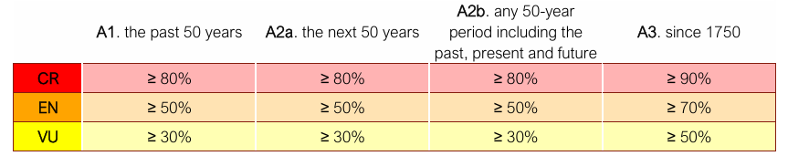
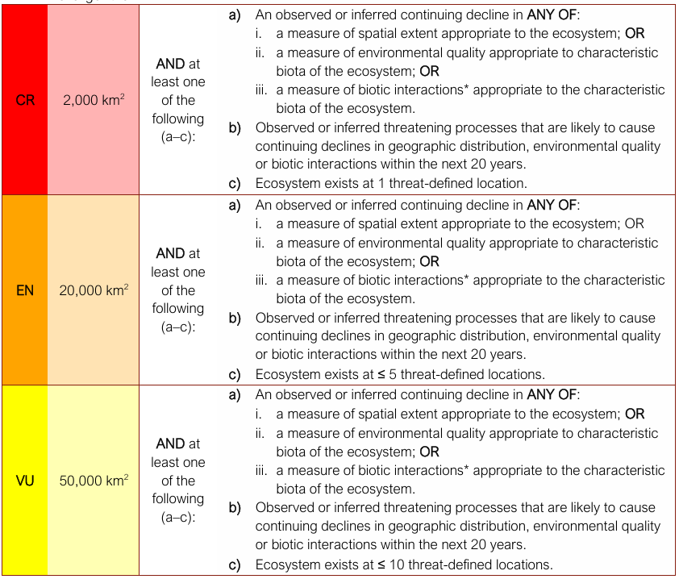
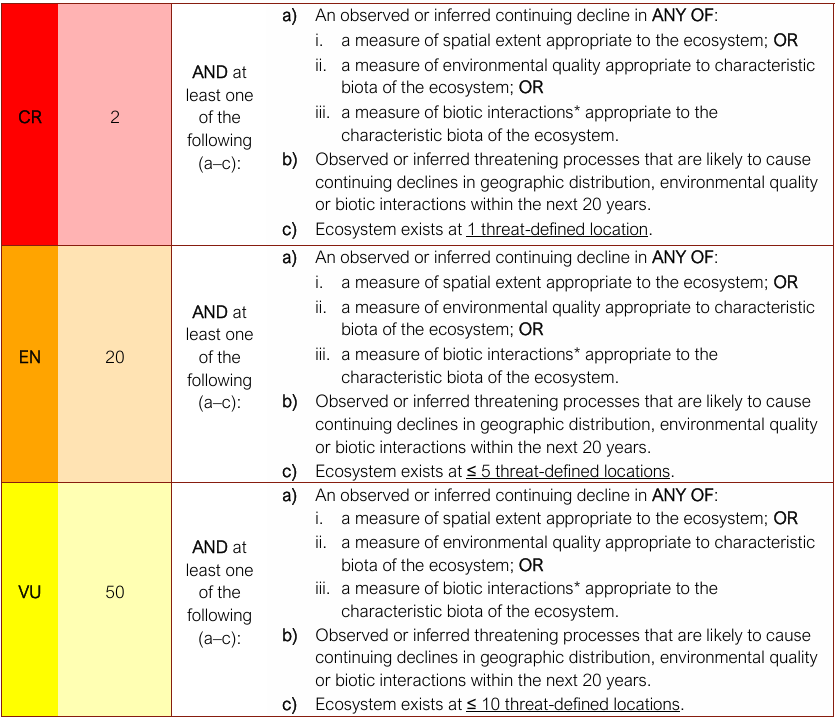

## Assessment Criteria

### Criterion A
**A. Reduction in geographic distribution** over **ANY** of the following time periods: {#fig-1 width="100%"}

### Criterion B
**B. Restricted geographic distribution** indicated by **ANY OF** B1, B2 or B3:

#### Subcriterion B1
**B1.** Extent of a minimum convex polygon enclosing all occurrences (extent of occurrence, EOO) is no larger than: {#fig-2 width="100%"}

#### Subcriterion B2
**B2.** The number of 10 × 10 km grid cells occupied (area of occupancy, AOO) is no more than: {#fig-3 width="100%"}

*\* Note: The full text of clauses B1(a)iii and B2(a)ii of the criteria, states “a measure of disruption to biotic interactions appropriate to…” (IUCN 2016). Alternative phrasing given here avoids potential misinterpretation associated with double-negative expression when that phrase is read in context with clause B1(a) or B2(a), respectively, “continuing decline” in “... a measure of \[disruption to\] biotic interactions”.*

### Data source
Source: [IUCN RLE Guidelines](https://portals.iucn.org/library/sites/library/files/documents/2024-021-En.pdf){target="_blank" rel="noopener noreferrer"}
